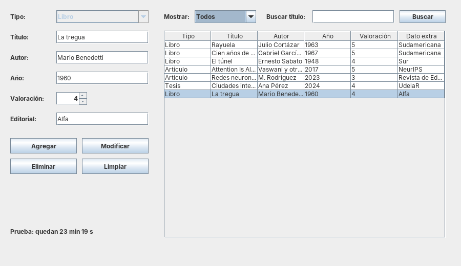
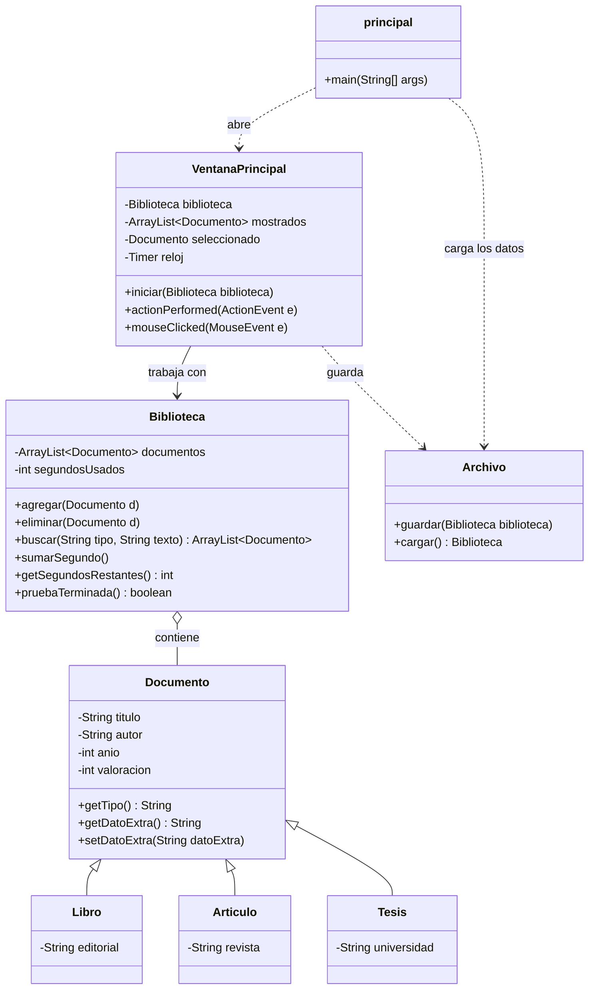
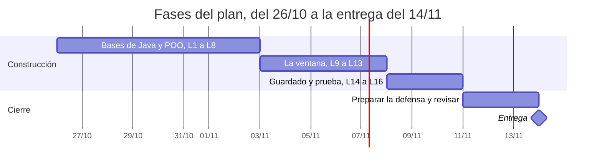

# Mi Biblioteca · Proyecto de Programación Avanzada

Grupo: Santy, Mati y Gabi · Plan actualizado el 25/10/2026

## Qué hay en este repo

| Carpeta | Qué tiene |
| --- | --- |
| [`lecciones`](lecciones/) | Las 16 lecciones, en orden, con los atajos de Eclipse |
| [`referencia`](referencia/) | El programa terminado y probado, para comparar |
| `ProyectoBiblioteca` | El proyecto de Eclipse del grupo (se crea en la Lección 1) |
| [`img`](img/) | Capturas |

## Lo que pide el profe

Hay que entregar un programa en Java, con ventanas hechas en Swing, que guarde y gestione datos de libros y otros documentos; la clase siguiente a la entrega se defiende, y esa defensa decide casi toda la nota. ([Consigna en Schoology](https://ceibal.schoology.com/course/8330038214/materials/gp/8610780792))

**Obligatorio** (marcalo a medida que lo tengas andando):

- [ ] Interfaz gráfica con Java Swing: ventanas, botones, campos de texto.
- [ ] Guardar datos de libros y de otros tipos de documento (artículos científicos, publicaciones…). No el contenido, sino datos como nombre, autor, fecha de lanzamiento y valoración.
- [ ] Poder agregar, ver, modificar y borrar esos datos.
- [ ] Persistencia: que los datos sigan ahí al cerrar y volver a abrir. En clase se usan archivos serializados; con SQL habría que saber las consultas y entregar el script que crea la base y las tablas.
- [ ] Versión de prueba: 30 minutos de uso en total. Después solo queda habilitado ver lo guardado.

**Suma puntos:**

- Filtrar por tipo de documento y buscar por nombre (u otro criterio).
- Una interfaz prolija.
- Que no se rompa en situaciones excepcionales: un año escrito con letras, campos vacíos, nada seleccionado, el archivo que todavía no existe.

**La defensa:**

- Es obligatoria para tener nota suficiente y es lo que más pesa.
- Pueden presentar como quieran, pero el profe puede preguntar por cualquier parte del código y pedir cambios en el momento.
- Cuentan la legibilidad y el orden. Si hay comentarios, el profe asume que es algo que no dominan: comentar de más puede bajar la nota.

## Fechas y grupo

El grupo es de tres: Santy, Mati y Gabi. La consigna permite como máximo 3 integrantes.

- 23/10/2026: último día para anotar el grupo en el [foro de Schoology](https://ceibal.schoology.com/course/8330038214/materials/discussion/view/8617517544), con nombre y apellido de cada integrante. Sin anotarse, cuenta como individual.
- 15/11/2026: entrega final.
- La clase siguiente a la entrega: defensa.

Aunque sean grupo, la defensa mide lo que sabe cada uno: todos tienen que poder explicar y modificar cualquier parte. Se reparten quién escribe cada cosa, pero todos hacen todas las lecciones.

## Qué vamos a construir

Vamos a construir «Mi Biblioteca»: una sola ventana con el formulario a la izquierda, la tabla de documentos a la derecha y el contador de prueba abajo. Así se ve una versión que armé para comprobar que todo el plan funciona; la tuya puede tener otro diseño.

Por dentro son 8 clases:

Leelo de arriba hacia abajo: `principal` arranca todo, la ventana trabaja con la `Biblioteca`, y `Libro`, `Articulo` y `Tesis` son documentos con un dato extra cada uno.

| Clase | La construís en |
| --- | --- |
| `principal` | L1 (y la terminás en L9) |
| `Documento` | L5 |
| `Libro`, `Articulo`, `Tesis` | L6 |
| `Biblioteca` | L7 |
| `VentanaPrincipal` | L9 a L13, y el contador en L15 |
| `Archivo` | L14 |

## El plan día por día

Son 20 días a 2 horas por día: 16 lecciones que arman el proyecto pieza por pieza y 3 días para preparar la defensa y revisar todo. Se entrega el 14/11, un día antes del límite. No hay día de margen: si uno se complica, no saltees lecciones y recuperalo al día siguiente.

Cada fase termina con una parte del programa andando; el detalle día por día está en la tabla.

| Día | Lección o tarea | Qué queda andando | Estado |
| --- | --- | --- | --- |
| Lun 26/10 | [L1 · Eclipse y tu primer programa](lecciones/leccion-01.md) | El proyecto creado y un programa que imprime en consola | Pendiente |
| Mar 27/10 | [L2 · Decisiones con if/else](lecciones/leccion-02.md) | Programas que deciden con if y else | Pendiente |
| Mié 28/10 | [L3 · Bucles: for y while](lecciones/leccion-03.md) | Ejercicios que recorren y cuentan datos de libros | Pendiente |
| Jue 29/10 | [L4 · Métodos y textos (String)](lecciones/leccion-04.md) | Tus primeros métodos propios | Pendiente |
| Vie 30/10 | [L5 · Clases y objetos](lecciones/leccion-05.md) | Clase `Documento` | Pendiente |
| Sáb 31/10 | [L6 · Herencia](lecciones/leccion-06.md) | Clases `Libro`, `Articulo` y `Tesis` | Pendiente |
| Dom 1/11 | [L7 · ArrayList y la clase Biblioteca](lecciones/leccion-07.md) | `Biblioteca` que agrega, borra y busca, probada en consola | Pendiente |
| Lun 2/11 | [L8 · Excepciones y parseo](lecciones/leccion-08.md) | Validación del año y de campos vacíos | Pendiente |
| Mar 3/11 | [L9 · WindowBuilder: JFrame y JPanel](lecciones/leccion-09.md) | La ventana abre desde `principal` | Pendiente |
| Mié 4/11 | [L10 · Componentes del formulario](lecciones/leccion-10.md) | Ventana con todos los campos y botones | Pendiente |
| Jue 5/11 | [L11 · Eventos: el botón Agregar](lecciones/leccion-11.md) | Agregar funciona y avisa los errores | Pendiente |
| Vie 6/11 | [L12 · JTable, filtro y búsqueda](lecciones/leccion-12.md) | La tabla muestra, filtra y busca | Pendiente |
| Sáb 7/11 | [L13 · Seleccionar, modificar y eliminar](lecciones/leccion-13.md) | Agregar, ver, modificar y borrar completos | Pendiente |
| Dom 8/11 | [L14 · Guardar y cargar (serialización)](lecciones/leccion-14.md) | Los datos sobreviven al cerrar | Pendiente |
| Lun 9/11 | [L15 · Versión de prueba de 30 minutos](lecciones/leccion-15.md) | Contador, bloqueo y tiempo guardado | Pendiente |
| Mar 10/11 | [L16 · Situaciones excepcionales y prolijidad](lecciones/leccion-16.md) | Programa terminado y ordenado | Pendiente |
| Mié 11/11 | Defensa 1 · Explicar cada clase y preguntas difíciles | Cuaderno de defensa completo, con respuestas propias | Pendiente |
| Jue 12/11 | Defensa 2 · Modificaciones en vivo y simulacro | Cambios típicos en menos de 10 minutos y simulacro aprobado | Pendiente |
| Vie 13/11 | Revisión final con el grupo | Proyecto exportado y probado en otra computadora | Pendiente |
| Sáb 14/11 | Entrega | Entregado con un día de margen | Pendiente |

## Cómo vamos a trabajar

Cada lección sigue el mismo ciclo, y no se avanza a la siguiente hasta que la anterior funcione y la puedas explicar.

1. Leés la lección (cada una tiene su archivo en la carpeta [lecciones](lecciones/)).
2. Escribís el código a mano en Eclipse. Copiar y pegar no vale: escribiéndolo es como se aprende y como lo vas a poder defender.
3. Lo ejecutás. Si da error, leés el mensaje rojo antes de pedir ayuda, y si no sale, me pasás el error completo.
4. Hacés los ejercicios y respondés las preguntas tipo defensa del final.
5. Me pegás tu código o una captura en el chat. Te corrijo y recién ahí pasamos a la siguiente.

Reglas de la casa:

- **El estilo del profe:** clase `principal`, atributos `private` con getters y setters, ventana hecha con WindowBuilder que implementa `ActionListener` y pregunta `e.getSource()`, guardado con `ObjectOutputStream`. Es lo que él espera ver y lo que te va a resultar más fácil explicar.
- **Nombres claros en vez de comentarios:** `btnAgregar`, `txtTitulo`, `cargarSeleccionado()`. Si el nombre explica qué hace, no hace falta comentario.
- **Cuaderno de defensa:** al terminar cada lección, escribí con tus palabras qué hace cada parte nueva. En la semana de defensa ese cuaderno vale oro.
- **Copia de seguridad:** el repo de GitHub. Al terminar cada lección: commit y push (ver «Trabajo en grupo con GitHub», más abajo).

## Trabajo en grupo con GitHub

Todo el proyecto vive en el repo [ProyectoProgramacion](https://github.com/santiperez1859-hash/ProyectoProgramacion), que compartís con Mati y Gabi: este plan, las 16 lecciones y el código completo de referencia. El repo es público, así que cualquiera puede verlo.

**La primera vez:**

1. Cada uno instala [GitHub Desktop](https://desktop.github.com/) y entra con su cuenta de GitHub.
2. Cada uno clona el repo: **File → Clone repository → URL**, pega `https://github.com/santiperez1859-hash/ProyectoProgramacion.git` y elige dónde guardarlo.
3. Santy agrega a Mati y Gabi como colaboradores: en el repo, **Settings → Collaborators → Add people**. Sin eso pueden bajar el repo, pero no subir cambios.
4. En la Lección 1, Santy crea el proyecto de Eclipse adentro de la carpeta del repo y lo sube. Mati y Gabi hacen **Pull** y lo abren con **File → Import → General → Existing Projects into Workspace**: en *Select root directory* eligen la carpeta del repo y tocan **Finish**.

**En cada lección:**

1. **Pull** antes de empezar, para tener lo último.
2. Una sola persona escribe el código del proyecto y los demás acompañan. Se turnan por lección, así nadie pisa el trabajo de otro.
3. Al terminar, quien escribió hace **Commit** con un mensaje que diga qué hizo (por ejemplo «Lección 5: clase Documento») y **Push**.
4. Los demás hacen **Pull** y repasan la lección entera: en la defensa le pueden preguntar cualquier parte a cualquiera.

Si querés escribir la lección por tu cuenta para practicar, hacelo, pero antes del Pull descartá tus cambios (en GitHub Desktop: clic derecho en la lista de cambios → **Discard all changes**). Las prácticas del paquete `practica`, el archivo `biblioteca.bin` y la carpeta `bin` no se suben: el `.gitignore` del repo ya los deja afuera.

## Lecciones

Las 16 lecciones están en la carpeta [lecciones](lecciones/), cada una en su archivo y en orden; se empieza por [Lección 1 · Eclipse y tu primer programa](lecciones/leccion-01.md). El programa terminado, clase por clase, está en [referencia](referencia/): sirve para comparar lo tuyo, no para saltearte las lecciones.

## Preparación para la defensa

La defensa se gana practicando dos cosas: explicar cada parte con tus palabras y hacer cambios chicos en vivo sin trabarte. Esta lista crece con cada lección; el 11 y el 12/11 la repasamos entera.

**Preguntas que el profe puede hacer:**

1. ¿Por qué `Libro`, `Articulo` y `Tesis` heredan de `Documento`? ¿Qué ganás con la herencia?
2. ¿Qué hace `super(...)` en el constructor de `Libro`?
3. ¿Qué es sobrescribir un método (`@Override`)? Mostrá un ejemplo en tu código.
4. ¿Por qué los atributos son `private`? ¿Cómo se leen y se cambian desde otra clase?
5. ¿Dónde están los documentos mientras el programa está abierto? ¿Y cuando se cierra?
6. ¿Qué pasa la primera vez que abrís el programa, cuando el archivo todavía no existe?
7. ¿Para qué sirve `implements Serializable`?
8. ¿Cómo sabe `actionPerformed` qué botón se apretó?
9. ¿Qué pasa si en el año escriben letras? Mostrá dónde lo controlás.
10. ¿Cómo se cuentan los 30 minutos? Si cierro el programa a los 10 minutos y lo vuelvo a abrir, ¿cuánto queda?
11. ¿Por qué usaste un `Timer` de Swing y no el hilo (`ExecutorService`) que dio el profe?
12. ¿Qué pasa si alguien borra el archivo `biblioteca.bin`?

**Modificaciones en vivo para practicar** (cronometrate: menos de 10 minutos cada una):

- [ ] Cambiar el tiempo de prueba a 10 minutos.
- [ ] Agregar un atributo nuevo a `Documento` (por ejemplo, el idioma) y mostrarlo en la tabla.
- [ ] Agregar un tipo nuevo de documento, por ejemplo `Revista`.
- [ ] Buscar por autor además de por título.
- [ ] Que la valoración vaya de 1 a 10.
- [ ] Mostrar un aviso cuando la búsqueda no encuentra nada.
